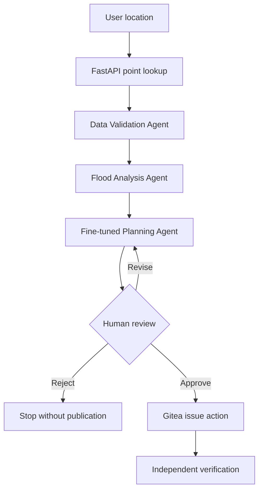

# ClimateAdapt AI

ClimateAdapt AI is a research prototype for planning-level coastal flood
susceptibility screening in Nelson, Aotearoa New Zealand. It combines a compact
U-Net, uncertainty estimation, physical plausibility controls, a fine-tuned
local language model and a human-controlled three-agent workflow.

The prototype is **not** a hydrodynamic model, engineering design tool,
regulatory decision system or emergency-warning service.

## Prototype capabilities

- Produces 5 m coastal-flood susceptibility screening from elevation, slope,
  distance-to-coast and LCDB land-cover inputs.
- Serves instant point queries from precomputed full-region GeoTIFF products.
- Reports predictive uncertainty using Monte Carlo dropout.
- Applies an explainable terrain and coastal-connectivity guardrail.
- Coordinates Data Validation, Flood Analysis and Planning Support agents with
  LangGraph.
- Uses a QLoRA fine-tuned Qwen3 4B model through Ollama for constrained planning
  language.
- Requires explicit human approval before publishing a planning brief.
- Creates and independently verifies approved issues in a private Gitea
  repository.
- Records explainability, environmental data-bias and safe-failure evidence.

## System architecture



LangGraph owns the workflow state and conditional routing. The prediction API
reads frozen regional outputs and does not rerun the U-Net for each point.

## Machine-learning components

### Compact U-Net V2

- Architecture: GroupNorm Compact U-Net
- Input channels: 25
- Parameters: approximately 1.95 million
- Tile size: 128 × 128 pixels
- Ground coverage per tile: 640 × 640 m
- Training regions: Nelson CBD and Nelson Haven
- Validation region: Rocks Road
- Independent test region: Tāhunanui
- Demonstration region: Waimea Inlet and Monaco
- Frozen operational threshold: 0.54, selected only with validation data

Independent Tāhunanui results at the operational threshold:

| Metric | Result |
| --- | ---: |
| Balanced accuracy | 0.6837 |
| Precision | 0.8357 |
| Recall | 0.4395 |
| F2 | 0.4855 |
| Dice | 0.5760 |
| IoU | 0.4045 |
| ROC-AUC | 0.8530 |
| Average precision | 0.8218 |

### Baseline and uncertainty evidence

The logistic-regression baseline achieved higher recall and Dice on the
independent test geography, while the U-Net produced higher precision at the
predeclared operational threshold. This comparison is retained rather than
hidden because it demonstrates model-selection trade-offs and prototype
limitations.

Monte Carlo dropout showed that the most uncertain 10% of pixels had an error
rate approximately 2.29 times the overall rate. This supports uncertainty-based
human review.

### Explainability and environmental data bias

Grouped ablation identified distance to the coastline as the strongest tested
input dependency; removing it reduced average precision by 0.1245. Flood-label
prevalence differed by 35.62 percentage points across geographic splits, and
subgroup recall varied by 0.9208. Seven LCDB classes in the full-region screen
were unseen during training: 12, 30, 43, 45, 50, 55 and 58.

These are environmental/spatial data-bias findings. They are not demographic
fairness results, and ablation importance must not be interpreted as causation.

## Planning language model

The planning model is a QLoRA fine-tuned Qwen3 4B model exported to GGUF and
served locally through Ollama as `climateadapt-planner:4b`.

On the held-out instruction test set, fine-tuning improved:

| Metric | Base | Fine-tuned |
| --- | ---: | ---: |
| Status accuracy | 0.2593 | 0.7778 |
| Task-guardrail accuracy | 0.2593 | 0.7778 |
| Reference-token F1 | 0.3911 | 0.8031 |
| Behaviour score | 0.7689 | 0.9323 |

The test split was not used for further tuning.

## Repository structure

```text
configs/                 Project configuration
dashboard/               Streamlit user interface
data/                    Data documentation and generated instruction data
docs/                    Architecture and assessment evidence documentation
evidence/figures/        Reproducible figures used as evidence
models/                  Model documentation; large weights excluded from Git
outputs/                 Small metrics and reports; large rasters excluded
scripts/                 Numbered reproducible pipeline entry points
src/climateadapt/        Reusable models, API and agent modules
tests/                   Automated tests
```

The numbered scripts are intentional: they preserve the order and provenance of
the prototype experiments. Reusable application logic is kept under `src/`.

## Local setup

Python 3.12 is recommended.

```powershell
py -3.12 -m venv .venv
.\.venv\Scripts\Activate.ps1
python -m pip install --upgrade pip
pip install -r requirements.txt
```

PyTorch with a CUDA build is optional but recommended for U-Net training and
inference. Point serving from precomputed rasters does not require a GPU.

## Required local services

1. Ollama with `climateadapt-planner:4b`
2. Gitea with a private repository and Issues enabled
3. The ClimateAdapt prediction API

Gitea credentials must be supplied as environment variables and must never be
committed:

```powershell
$env:CLIMATEADAPT_GITEA_URL   = "http://127.0.0.1:3000"
$env:CLIMATEADAPT_GITEA_OWNER = "your-user"
$env:CLIMATEADAPT_GITEA_REPO  = "climateadapt-ai"
$env:CLIMATEADAPT_GITEA_TOKEN = "your-token"
```

## Run the prototype

Start the point-prediction API:

```powershell
python .\scripts\30_run_prediction_api.py
```

Run the live LangGraph workflow:

```powershell
python .\scripts\31_run_live_agent_workflow.py `
  --latlon -41.29 173.24 `
  --name "Nelson example"
```

Run the human-approved Gitea workflow:

```powershell
python .\scripts\32_run_gitea_agent_workflow.py `
  --latlon -41.29 173.24 `
  --name "Nelson example" `
  --reviewer "Prototype reviewer"
```

Run the final audits:

```powershell
python .\scripts\33_audit_explainability_bias_v2.py
python .\scripts\34_run_robustness_audit.py
```

The robustness audit completed 17/17 checks with zero Gitea write operations
and zero detected secret leaks.

## Data and model files

Raw LINZ/NCC/LCDB datasets, processed GeoTIFFs and trained model binaries are
excluded from Git because of size, licensing, provenance and security
considerations. Reproduce or place them according to `data/README.md` and the
pipeline scripts. Do not commit API tokens or `.env` files.

## Responsible-use boundary

Every output requires GIS, engineering, community and authorised human review.
The prototype does not model water depth, velocity, drainage capacity, tides,
storm surge or infrastructure failure. No automated emergency, funding,
regulatory, cultural-value or land-use decision should be made from it.

