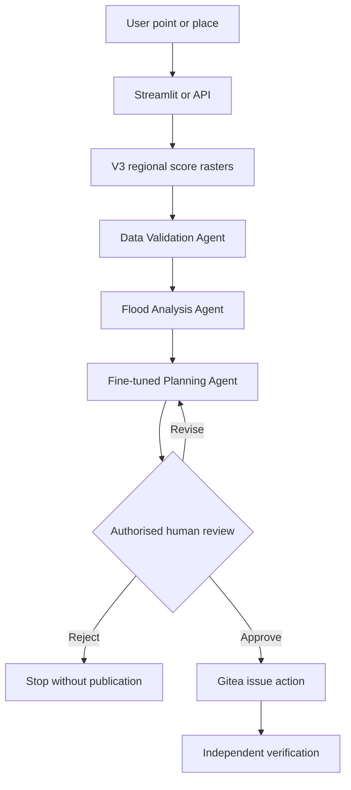

# ClimateAdapt AI

ClimateAdapt AI is a research prototype for planning-level coastal-flood
susceptibility screening across the prepared Nelson region of Aotearoa New
Zealand. It combines geospatial machine learning, a FastAPI prediction service,
a Streamlit place-analysis dashboard, a locally served fine-tuned language
model, and a human-controlled three-agent workflow.

The deployed V3 prediction component is a logistic-regression classifier. It
returns an **uncalibrated susceptibility score**, not the probability, depth, or
extent of a future flood.

The prototype is **not** a hydrodynamic model, engineering design tool,
regulatory decision system, or emergency-warning service.

## Final V3 system

- Produces 5 m coastal-flood susceptibility screening from elevation, slope,
  distance-to-coast, and LCDB land-cover inputs.
- Uses a V3 logistic-regression model as the deployed primary predictor.
- Serves instant point queries from precomputed full-region GeoTIFF products.
- Supports radius-based place analysis at 500 m, 1 km, and 2 km through the
  Streamlit dashboard.
- Coordinates Data Validation, Flood Analysis, and Planning Support agents with
  LangGraph.
- Uses a QLoRA fine-tuned Qwen3 4B model through Ollama for constrained planning
  language.
- Requires authorised human review before a planning brief can be treated as
  approved or published to Gitea.
- Independently verifies an approved Gitea issue rather than trusting the
  agent's own report of success.
- Retains V2 U-Net, uncertainty, physical-guardrail, explainability, and
  robustness results as development evidence.

## System architecture



LangGraph owns workflow state and conditional routing. The API reads frozen,
precomputed regional outputs; it does not retrain a model or open flood-label
rasters while serving a request.

## V3 structured prediction

### Data and leakage control

The V3 dataset uses a frozen geographic split with a cross-split separation
belt. Normalisation statistics were calculated using the training split only.
The locked test tiles were prepared mechanically but were not opened during
training, checkpoint selection, or threshold selection.

| Split | Coastal areas | Valid cells | Flood cells | Flood prevalence |
| --- | --- | ---: | ---: | ---: |
| Training | Nelson CBD, Nelson Haven, Rocks Road, Tahunanui, Waimea Inlet | 959,043 | 79,027 | 8.24% |
| Validation | Boulder Bank Glenduan, Delaware Bay estuary | 772,823 | 53,407 | 6.91% |
| Locked test | Delaware Open Coast, Oananga Bay | 723,533 | 38,366 | 5.30% |

The tile dataset contains 319 training tiles, 262 validation tiles, and 246
locked-test tiles. Each tile is 128 x 128 pixels with a stride of 64 pixels.
Overlapping predictions are merged before area-level metrics are calculated.

### Feature claims

The model uses 11 engineered input channels derived from:

- elevation, representing vertical exposure;
- terrain slope, representing local terrain steepness;
- log-transformed distance to the coastline, representing coastal proximity;
- one-hot land-cover information, representing differing surface contexts.

These variables encode screening hypotheses and associations. They do not prove
that any individual feature causes flooding.

### Baselines and model selection

V3 compared three predefined alternatives on validation data:

- a trivial training-prevalence baseline;
- logistic regression from the symbolist/statistical linear-classifier tribe;
- a GroupNorm Compact U-Net from the neural-learning tribe.

The trivial baseline achieved validation average precision of 0.0691 and an F2
score of 0. The logistic baseline achieved validation average precision of
0.6619. Its operational threshold of `0.004` was selected on validation data
using F2 because missed susceptible locations carry a higher screening cost
than additional locations sent for human review.

The V3 U-Net achieved validation PR-AUC of 0.7209 and therefore beat the
predeclared logistic validation target of 0.6619. However, the final locked
geographic test showed substantially better transfer from logistic regression.
No model weights, features, splits, or thresholds were changed using the test
results. The prototype deployment preference was nevertheless informed by this
final comparison. Therefore, this locked test must not be presented as a still-
untouched confirmatory test of the deployed logistic choice; a new independent
geography would be required for that claim.

### Final locked geographic test

| Model | Average precision | Precision | Recall | F2 | Dice |
| --- | ---: | ---: | ---: | ---: | ---: |
| Trivial prevalence | 0.0530 | 0.0000 | 0.0000 | 0.0000 | 0.0000 |
| **Logistic regression (deployed)** | **0.9509** | **0.8183** | **0.9652** | **0.9317** | **0.8857** |
| V3 U-Net, operational threshold | 0.6680 | 0.5745 | 0.7077 | 0.6764 | 0.6342 |
| V3 U-Net, Dice comparison threshold | 0.6680 | 0.7399 | 0.4982 | 0.5330 | 0.5955 |

The evaluation merged overlapping predictions into 722,874 unique test pixels,
including 38,321 positive pixels. This differs slightly from the complete split
mask count because only pixels covered by the mechanically prepared test tiles
enter the model comparison.

The deployed logistic threshold remains `0.004`, frozen from validation. The V3
U-Net operational threshold is `0.20`; these thresholds belong to different
models and are not interchangeable.

### Full-region V3 screening

The final V3 logistic model was applied label-blind across the prepared Nelson
region:

| Item | Result |
| --- | ---: |
| Evaluated land cells | 31,107,322 |
| Evaluated land area | 777.683 km² |
| Flagged susceptible cells | 1,657,479 |
| Flagged susceptible area | 41.437 km² |
| Flagged percentage | 5.33% |
| Mean susceptibility score | 0.025799 |
| Unknown LCDB cells | 0 |

The susceptibility score is not calibrated as a flood probability. A location
above `0.004` is flagged for screening-level human review, not declared flooded.

## Retained V2 research evidence

V2 used a 25-channel GroupNorm Compact U-Net trained on Nelson CBD and Nelson
Haven, validated on Rocks Road, and tested independently on Tahunanui. At its
frozen operational threshold of `0.54`, it achieved average precision of
0.8218, precision of 0.8357, recall of 0.4395, F2 of 0.4855, and Dice of 0.5760.

V2 Monte Carlo dropout showed that the most uncertain 10% of pixels had an
error rate approximately 2.29 times the overall error rate. The V2 physicalist
terrain and coastal-connectivity guardrail retained 79.37% of candidate cells
as physically supported and routed uncertain supported cells to human review.
These results remain useful experimental evidence but do not describe the
deployed V3 predictor.

Grouped V2 ablation identified coastline distance as the strongest tested input
dependency; removing it reduced average precision by 0.1245. The audit also
recorded geographic prevalence and environmental subgroup differences. These
are environmental/spatial data-bias findings, not demographic fairness results,
and attribution must not be interpreted as proof of causation.

## Planning language model

The Planning Support Agent uses a QLoRA fine-tuned Qwen3 4B model exported to
GGUF with Q4_K_M quantisation and served locally through Ollama as
`climateadapt-planner:4b`.

On the held-out instruction test set, fine-tuning improved:

| Metric | Base Qwen3 4B | Fine-tuned model |
| --- | ---: | ---: |
| Status accuracy | 0.2593 | 0.7778 |
| Task-guardrail accuracy | 0.2593 | 0.7778 |
| Numeric fidelity | 0.9590 | 0.9785 |
| Reference-token F1 | 0.3911 | 0.8031 |
| Behaviour score | 0.7689 | 0.9323 |

The held-out test split was used only for the final comparison and was not used
for further prompt or model tuning.

## Three-agent workflow

1. **Data Validation Agent** checks service identity, model provenance,
   coordinate coverage, raster alignment, threshold provenance, and required
   fields.
2. **Flood Analysis Agent** interprets the verified susceptibility score and
   area statistics using screening-score semantics.
3. **Planning Support Agent** uses the fine-tuned local LLM to draft constrained
   planning language with mandatory limitations and escalation behaviour.

LangGraph then pauses at a human-review checkpoint. Approval, revision, and
rejection are explicit workflow branches. Gitea publication is prohibited
unless the saved workflow state contains recorded human approval.

## Repository structure

```text
configs/                 Project configuration
dashboard/               Streamlit user interface
data/                    Raw, processed, tile and instruction-data locations
docs/                    Architecture, setup and assessment documentation
evidence/figures/        Reproducible figures used as evidence
models/                  Local model files; large binaries excluded from Git
notebooks/               Supporting notebooks
outputs/                 Metrics and reports; large rasters excluded from Git
scripts/                 Numbered reproducible pipeline entry points
src/climateadapt/        Reusable model, analysis and agent modules
tests/                   Automated tests
```

The numbered scripts are intentional: they preserve experimental order and
provenance. Reusable application logic is kept under `src/climateadapt/`.

## Local setup

Python 3.12 is recommended.

```powershell
py -3.12 -m venv .venv
.\.venv\Scripts\Activate.ps1
python -m pip install --upgrade pip
pip install -r requirements.txt
```

PyTorch with CUDA is optional but useful for U-Net training. The deployed V3
logistic service reads precomputed rasters and does not require a GPU.

## Required local services

1. Ollama with `climateadapt-planner:4b`
2. Gitea with a private repository and Issues enabled
3. The ClimateAdapt prediction API

Configure Gitea in the terminal used for the Gitea workflow:

```powershell
$env:CLIMATEADAPT_GITEA_URL   = "http://127.0.0.1:3000"
$env:CLIMATEADAPT_GITEA_OWNER = "your-user"
$env:CLIMATEADAPT_GITEA_REPO  = "climateadapt-ai"

$secureToken = Read-Host "Paste the Gitea token" -AsSecureString
$env:CLIMATEADAPT_GITEA_TOKEN = `
  [System.Net.NetworkCredential]::new("", $secureToken).Password
```

Never commit the token, place it in a command-line argument, or include it in
workflow evidence.

## Run the prototype

Start the V3 prediction API:

```powershell
python .\scripts\30_run_prediction_api.py
```

Open the API documentation at `http://127.0.0.1:8000/docs`.

In a second terminal, start the Streamlit interface:

```powershell
streamlit run .\dashboard\app.py
```

Run the live three-agent workflow:

```powershell
python .\scripts\31_run_live_agent_workflow.py `
  --latlon -41.29 173.24 `
  --name "Nelson V3 example"
```

Run the human-approved and independently verified Gitea workflow:

```powershell
python .\scripts\32_run_gitea_agent_workflow.py `
  --latlon -41.29 173.24 `
  --name "Nelson V3 example" `
  --reviewer "Prototype reviewer"
```

## Verification commands

```powershell
python .\scripts\46_test_prediction_api_v3.py
python .\scripts\47_test_v3_agent_integration.py
python .\scripts\49_test_v3_area_analysis.py
python .\scripts\34_run_robustness_audit.py
python .\scripts\35_evaluate_composed_system.py
```

The recorded robustness audit completed 17/17 predefined checks. The repeated
composed-system evaluation passed 9/9 cases, respected the human boundary, and
performed no Gitea mutation during the non-destructive audit.

## Data and model files

Raw LINZ/NCC/LCDB datasets, processed GeoTIFFs, and trained model binaries are
excluded from Git because of size, licensing, provenance, and security
considerations. Reproduce or place them according to the data documentation and
numbered pipeline scripts. Do not commit tokens, `.env` files, local secrets,
raw licensed data, or large model binaries.

## Responsible-use boundary

Every output requires GIS, engineering, community, and authorised human review.
The prototype does not model water depth, velocity, drainage capacity, rainfall,
tides, storm surge, defence failure, or infrastructure failure. No automated
emergency, funding, regulatory, cultural-value, insurance, property, or
land-use decision should be made from its output.

Before production use, the system would require broader independent validation,
calibration, hydrodynamic integration, monitored data pipelines, security and
privacy controls, model and data drift monitoring, operational ownership,
incident response, accessibility review, stakeholder consultation, and formal
governance.

## Trained planning-language model

The Planning Support Agent uses `climateadapt-planner:4b`, a QLoRA-adapted Qwen3-4B model exported to GGUF with Q4_K_M quantisation and served locally through Ollama.

The approximately 2.5 GB GGUF is excluded from Git because of its size. The separately supplied release contains the trained model, portable Ollama `Modelfile`, authentic Unsloth training notebook, model card, reproducibility guide, installation instructions and SHA-256 checksums.

**University OneDrive model release:** `[LINK TO BE ADDED BEFORE SUBMISSION]`

Inspectable repository resources:

- Training notebook: `notebooks/28_finetune_qwen3_4b_qlora_colab.ipynb`
- Model card: `docs/model_cards/climateadapt_planner_4b.md`
- Reproducibility guide: `docs/LLM_REPRODUCIBILITY.md`
- Release-packaging script: `scripts/53_prepare_language_model_release.py`
- Instruction dataset: `data/instruction/`
- Fine-tuning evidence: `outputs/language_finetuning_v1/`
- Held-out comparison: `outputs/language_model_comparison_v1/`

The supplied model remains a research prototype. It generates constrained planning language from verified ClimateAdapt evidence, but every planning interpretation requires authorised human review.
