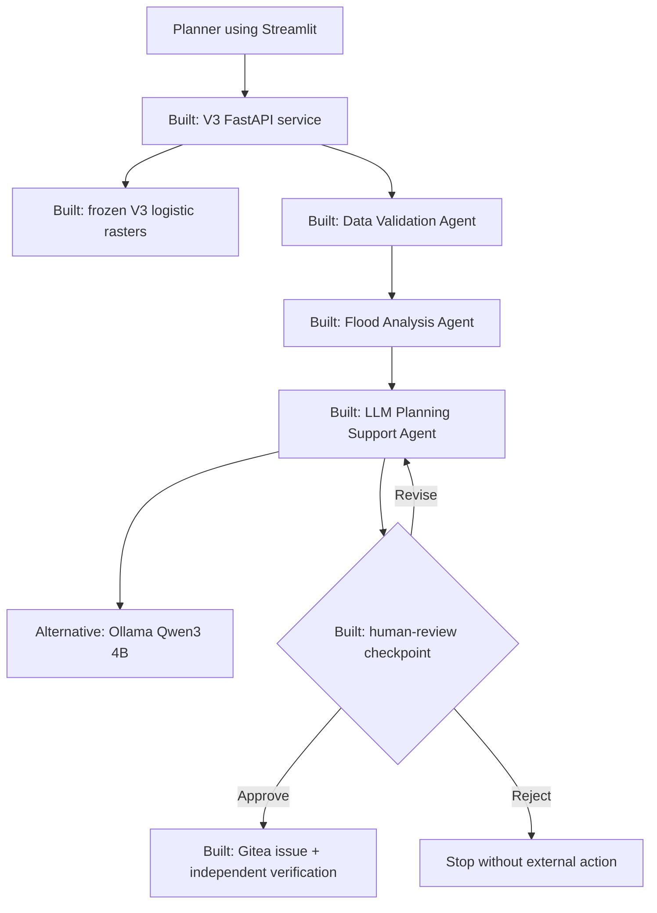

# ClimateAdapt AI V3 — Assessment 2 Architecture

## Architectural boundary

The system accepts a location request and returns screening-level coastal-flood
susceptibility evidence. Serving reads precomputed, aligned V3 rasters; it does
not train a model or access flood labels. The primary output is an uncalibrated
logistic susceptibility score with a validation-frozen operational threshold of
`0.004`, not flood probability.

## Components built in the project

- Full-region geospatial preparation and frozen geographic split.
- V3 trivial, logistic-regression and GroupNorm compact U-Net experiments.
- Locked Delaware Open Coast and Oananga Bay evaluation.
- Exact logistic attribution and environmental/spatial subgroup audit.
- Label-blind full-region logistic inference and FastAPI lookup service.
- Streamlit point and radius-based place analysis.
- Instruction dataset, QLoRA fine-tuning, GGUF Q4_K_M export and held-out
  base-versus-fine-tuned comparison.
- Three-agent LangGraph workflow with an LLM-powered Planning Support Agent.
- Schema validation, deterministic LLM fallback and mandatory human review.
- Gitea issue creation after approval and independent read-back verification.
- V3 robustness and repeated composed-system evaluation.

## EduStack/OpenClaw relationship

| Assessment role | Implemented alternative | Status |
|---|---|---|
| Agent orchestration | LangGraph | Built |
| Local model serving/backend selection | Ollama with base and fine-tuned model names | Built |
| Real repository artefact | Gitea issue | Built |
| EduStack runtime | Local Windows environment | Not used |
| OpenClaw agent | LangGraph agent workflow | Not used; tutor-approved substitution |

The report must state the substitution explicitly and retain evidence of tutor
approval if available.

## Intentionally absent from the prototype

- Hydrodynamic flood-depth, velocity, tide or drainage simulation.
- Live rainfall, tide, storm-surge or emergency feeds.
- Automatic land-use, regulatory, engineering, funding or emergency actions.
- Public release without authorised human approval.
- Production identity management, HTTPS, monitoring, redundancy and cloud
  deployment.

These are declared production gaps rather than hidden prototype features.
