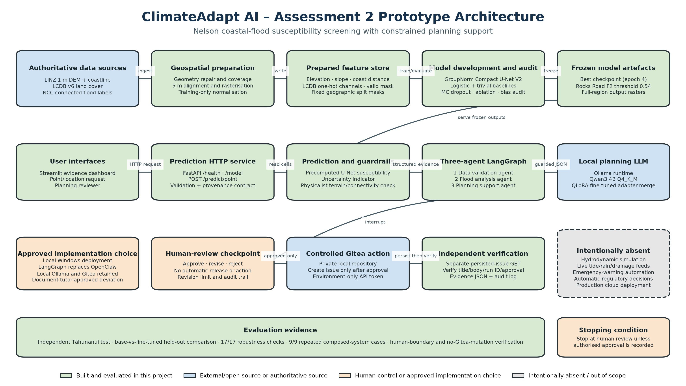

# ClimateAdapt AI – Assessment 2 Architecture

## Architectural boundary

The prototype accepts a location request and returns screening-level coastal-flood
susceptibility evidence. The FastAPI service reads frozen full-region prediction
rasters; it does not retrain the model or access flood labels during serving. Three
LangGraph agents validate the response, interpret it conservatively and ask the
fine-tuned local planning language model to produce a schema-constrained brief.
Execution stops at an implementable human-review checkpoint. Only an explicit
approval permits creation of a private Gitea issue, which is independently read
back and verified.

## Components built in this project

- Geospatial validation, repair, alignment and rasterisation pipeline.
- Compact GroupNorm U-Net V2 training and frozen threshold selection.
- Trivial and logistic-regression baselines.
- Independent spatial evaluation, MC-dropout uncertainty, grouped feature
  ablation, environmental subgroup audit and Physicalist guardrail.
- Full-region precomputation and point-prediction HTTP API.
- Instruction dataset, QLoRA fine-tuning workflow and base-versus-fine-tuned
  evaluation.
- Three-agent LangGraph workflow, deterministic LLM safety fallback, human
  checkpoint, controlled Gitea action and independent verification.
- Streamlit dashboard, robustness audit and repeated composed-system evaluation.

## External and open-source components

- LINZ DEM and coastline data, LCDB v6 land cover and NCC flood-label polygons.
- Python, PyTorch, Rasterio, GeoPandas, scikit-learn, FastAPI and Streamlit.
- LangGraph orchestration, Ollama inference, Qwen3 4B base model and Gitea.

## Approved platform substitution

The implementation uses a local Windows deployment and LangGraph orchestration
instead of the supplied EduStack/OpenClaw path. This reflects the tutor's stated
permission to use an alternative platform. The technical report should preserve
written evidence of that approval if available and describe the substitution
explicitly rather than implying that OpenClaw or CT200 was used.

## Intentionally absent components

The prototype does not contain a hydrodynamic simulator, live rainfall/tide or
drainage feeds, flood-depth or velocity prediction, emergency-warning automation,
automatic regulatory/engineering/funding decisions, or production cloud
deployment. These are production requirements and limitations, not hidden
features of the prototype.
