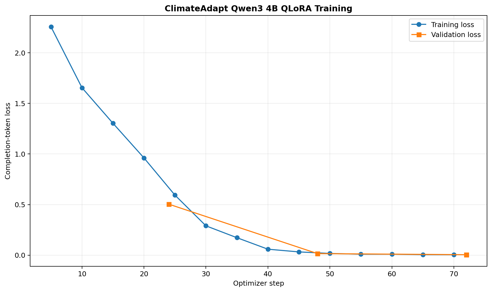

# QLoRA training evidence

## Configuration

ClimateAdapt fine-tuned `unsloth/Qwen3-4B-unsloth-bnb-4bit` with 4-bit QLoRA using 192 training examples and 24 validation examples. The held-out test split was not accessed during training. LoRA rank and alpha were both 16; training used 3 epochs, a learning rate of 0.0001, effective batch size 8, maximum sequence length 2048, completion-only loss, and seed 8532 on a Tesla T4.

## Loss evidence

- First logged training loss: **2.257735**
- Final logged training loss: **0.003734**
- Trainer-reported mean training loss: **0.511762**
- Best validation loss: **0.004355**
- Training time: **16.88 minutes**

| Epoch | Step | Validation loss |
|---:|---:|---:|
| 1 | 24 | 0.504063 |
| 2 | 48 | 0.015312 |
| 3 | 72 | 0.004355 |

## Overfitting interpretation

No classical loss-curve overfitting was observed during the three epochs: training loss decreased and validation loss improved at every epoch, with the lowest validation loss at the final epoch. This is limited evidence rather than proof of broad generalisation because validation contained only 24 examples drawn from the same constrained instruction-generation process. The independently held-out 27-example base-versus-fine-tuned evaluation is therefore treated as the stronger behavioural generalisation test.

The unusually low final validation loss must be interpreted cautiously. The examples use a strict JSON reporting schema and repeated safety vocabulary, so correct next-token prediction can become easy after fine-tuning. Validation loss should therefore be reported alongside the independently held-out behavioural comparison, not as a standalone claim of general language ability.

## Reproducibility and limitations

- Genuine Colab history and summary files are retained under `outputs/language_finetuning_v1/`.
- The trained test split remained held out until the final controlled comparison.
- Training and validation were generated from the same instruction-design process.
- The model remains a constrained planning-language component, not the flood-prediction model and not an autonomous decision-maker.
